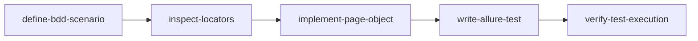

# 🚀 Core Skill: Automated Test Creation

This is the **central orchestrator skill** designed to conceive, design, implement, execute, and document new automated test cases for the **Hymnal Mobile App** (Appium + Pytest + POM + Allure BDD).

The workflow is structured into **5 specialized modular skills**:

---

## 🗺️ Workflow Architecture

---

## 📚 Modular Skills Index

| Skill | Purpose | Link |
|---|---|---|
| **`define-bdd-scenario`** | BDD scenario definition: Normalized ID (`SCN-xxx`), self-explanatory title, Given/When/Then structure, and immediate registration in `docs/test_scenarios.md`. | [SKILL.md](../define-bdd-scenario/SKILL.md) |
| **`inspect-locators`** | Android UI hierarchy inspection (XML/Maestro) and decoupled locator definition under strict priority (`ACCESSIBILITY_ID` > `ID` > `UiAutomator` > `XPATH`). | [SKILL.md](../inspect-locators/SKILL.md) |
| **`implement-page-object`** | Page Object implementation in `pages/` inheriting from `BasePage` or `MenuComponent`, using explicit waits and no assertions. | [SKILL.md](../implement-page-object/SKILL.md) |
| **`write-allure-test`** | Test authoring in `tests/test_<module>.py` with Allure BDD decorators, normalized SCN ID in `@allure.title`, and `allure.step` blocks. | [SKILL.md](../write-allure-test/SKILL.md) |
| **`verify-test-execution`** | Technical verification protocol: dry collection (`pytest --collect-only`), isolated test run, and Allure Report inspection. | [SKILL.md](../verify-test-execution/SKILL.md) |

---

## ⚡ Execution Guide

To implement a new automated test:
1. Activate **`define-bdd-scenario`** to define the scope, assign the unique ID (`SCN-xxx`), and record it immediately in `docs/test_scenarios.md`.
2. Use **`inspect-locators`** to extract element IDs and define robust selectors.
3. Invoke **`implement-page-object`** to encapsulate user actions and navigation methods in the POM classes.
4. Use **`write-allure-test`** to write declarative Pytest functions with Allure steps and title containing the scenario ID.
5. Run **`verify-test-execution`** to validate collection and test execution.
