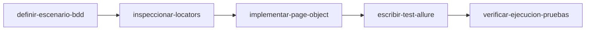

# 🚀 Skill Principal: Creación de Pruebas Automatizadas

Este es el **skill orquestador central** para diseñar, codificar, ejecutar y registrar nuevos casos de prueba automatizados en el proyecto **Hymnal Mobile App** (Appium + Pytest + POM + Allure BDD).

El proceso se apoya en **5 skills modulares especializados**:

---

## 🗺️ Mapa del Flujo de Trabajo

---

## 📚 Índice de Skills Modulares

| Skill | Propósito | Enlace al Skill |
|---|---|---|
| **`definir-escenario-bdd`** | Definición del escenario BDD: Nomenclatura normalizada (`SCN-xxx`), Título claro autoexplicativo, Given/When/Then y registro inmediato en `docs/test_scenarios.md`. | [SKILL.md](../definir-escenario-bdd/SKILL.md) |
| **`inspeccionar-locators`** | Inspección de vistas XML y definición de tuplas de locators con jerarquía de prioridad (`ACCESSIBILITY_ID` > `ID` > `UiAutomator` > `XPATH`). | [SKILL.md](../inspeccionar-locators/SKILL.md) |
| **`implementar-page-object`** | Implementación de Page Objects en `pages/` heredando de `BasePage` o `MenuComponent` con esperas explícitas y sin aserciones. | [SKILL.md](../implementar-page-object/SKILL.md) |
| **`escribir-test-allure`** | Codificación del test en `tests/test_<modulo>.py` con decoradores Allure BDD, código SCN en `@allure.title` y bloques `allure.step`. | [SKILL.md](../escribir-test-allure/SKILL.md) |
| **`verificar-ejecucion-pruebas`** | Verificación técnica de recolección (`pytest --collect-only`), ejecución individual y validación visual con Allure Report. | [SKILL.md](../verificar-ejecucion-pruebas/SKILL.md) |

---

## ⚡ Guía Rápida de Ejecución

Para desarrollar una nueva prueba automatizada:
1. Activar **`definir-escenario-bdd`** para acordar el alcance, asignar ID (`SCN-xxx`) y registrar el caso de inmediato en `docs/test_scenarios.md`.
2. Utilizar **`inspeccionar-locators`** para obtener los IDs y selectores del layout.
3. Invocar **`implementar-page-object`** para programar las acciones en los POM.
4. Usar **`escribir-test-allure`** para codificar el test en Pytest incluyendo el código en el título.
5. Ejecutar **`verificar-ejecucion-pruebas`** para correr la prueba y validar Allure.
