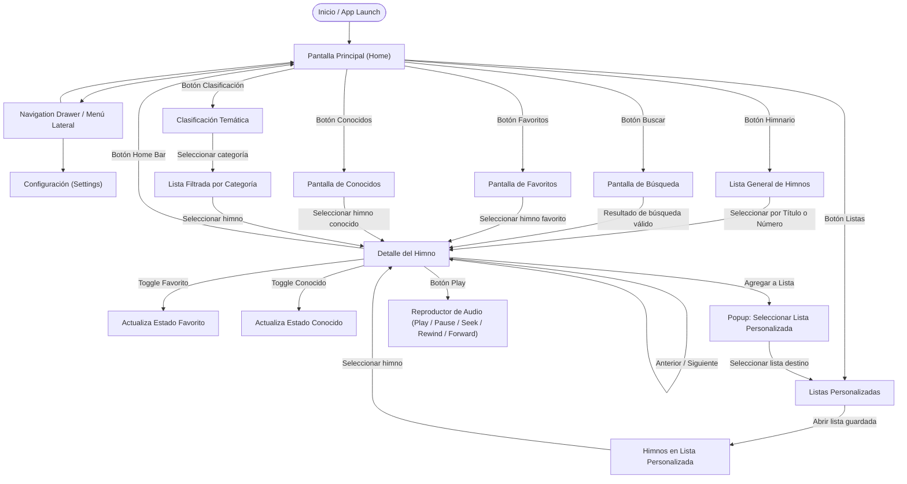
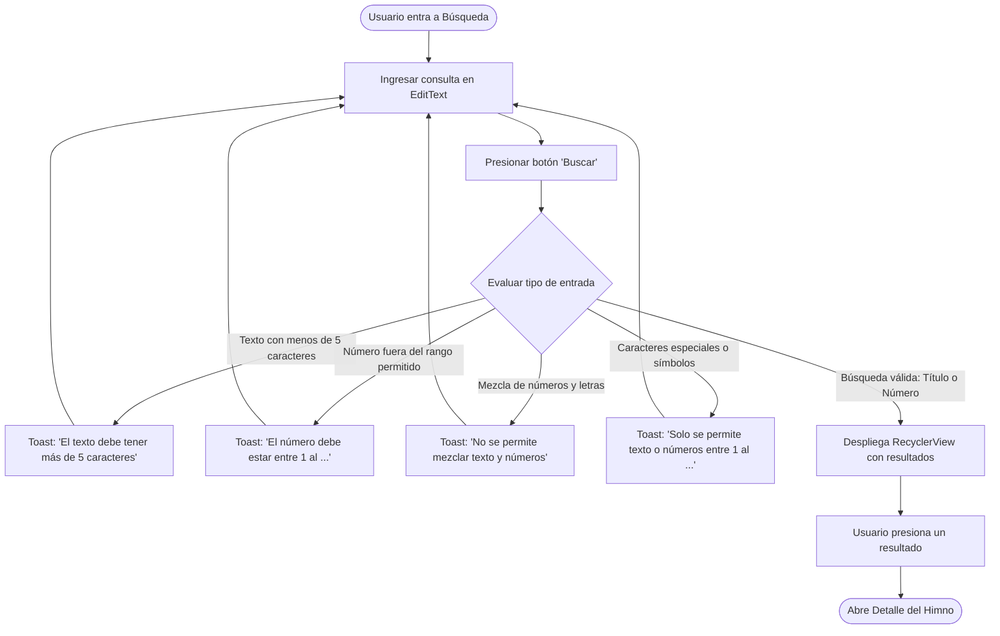
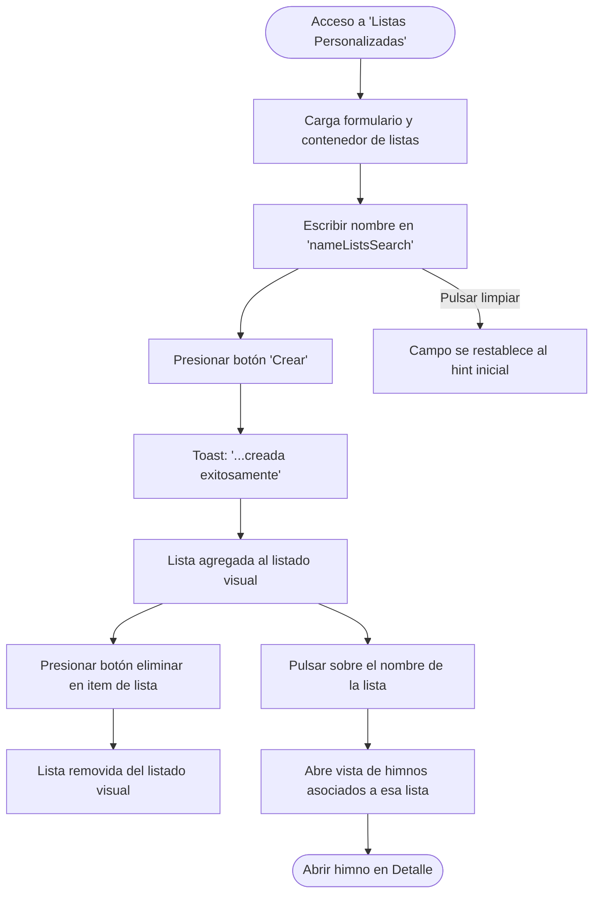
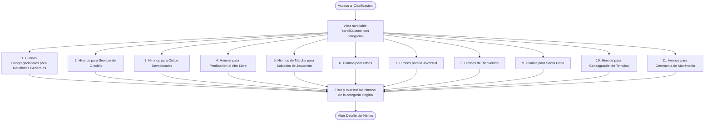
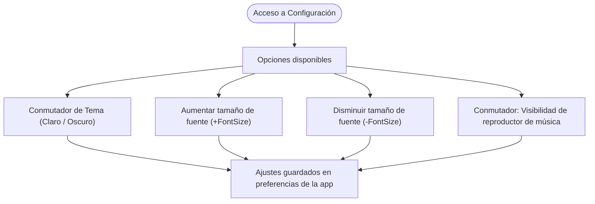
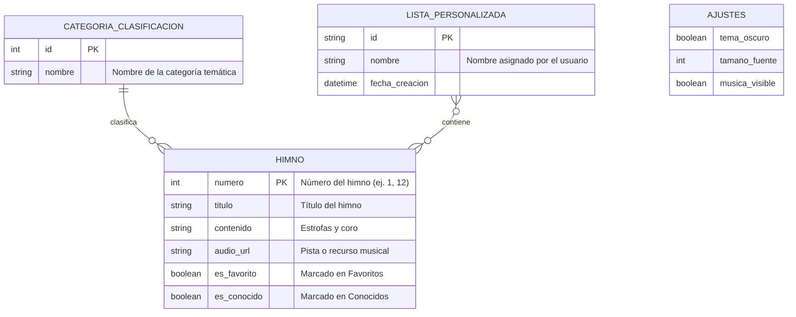

# 🗺️ Arquitectura y Diagrama de Flujo de la Aplicación

Este documento detalla el **entendimiento funcional y de navegación** de la aplicación móvil **Himnario Pentecostal** (`com.pentecostal.himnarioprincipal`), basado en la inspección de vistas XML, Page Objects, locators y casos de prueba automatizados.

---

## 1. Visión General de la Aplicación

La aplicación es un himnario digital nativo para Android (Kotlin + XML) orientado a la congregación, directores de culto y músicos. Permite:
- Consultar himnos organizados por número y título.
- Leer letras y estrofas completas.
- Reproducir pistas de audio acompañadas de controles multimedia.
- Marcar himnos como **Favoritos** y **Conocidos**.
- Crear y gestionar **Listas Personalizadas** para reuniones o cultos específicos.
- Explorar himnos agrupados por **Clasificación Temática** (Devocionales, Juventud, Niños, Santa Cena, etc.).
- Buscar himnos mediante filtros de texto o número con validaciones de entrada.
- Ajustar configuración visual y tipográfica (tamaño de fuente, tema).

---

## 2. Diagrama de Navegación Principal (Flujo Global)

El siguiente diagrama muestra el mapa general de pantallas y cómo el **Detalle del Himno** actúa como el punto de convergencia funcional de la app:



---

## 3. Flujos Detallados por Módulo

### 3.1. Flujo de Búsqueda y Validaciones de Entrada

La pantalla de búsqueda cuenta con reglas estrictas de validación que se comunican al usuario mediante mensajes Toast del sistema:



---

### 3.2. Flujo del Detalle del Himno y Reproductor Multimedia

El detalle del himno es la vista más rica de la aplicación, ya que integra lectura, audio y categorización personal:

```mermaid
flowchart TD
    D_Start(["Detalle del Himno Cargado"]) --> D_Render["Renderiza Título y Estrofas (TextViews)"]

    %% Acciones independientes
    D_Render --> D_Audio{"Interacción con Audio"}
    D_Audio -->|Pulsar Play| D_ShowPlayer["Muestra contenedor 'musicPlayerLayout'"]
    D_ShowPlayer --> D_Controls["Controles activos: Play / Pause, Rewind 10s, Forward 10s, SeekBar"]

    D_Render --> D_Meta{"Metadatos y Listas"}
    D_Meta -->|Pulsar Estrella/Favorito| D_Fav["Alterna flag de Favorito"]
    D_Meta -->|Pulsar Marca/Conocido| D_Known["Alterna flag de Himno Conocido"]
    D_Meta -->|Pulsar 'Añadir a Lista'| D_Popup["Abre Popup modal con listas creadas"]
    D_Popup -->|Selecciona lista| D_Saved["Vincula himno a la lista seleccionada"]
    D_Popup -->|Pulsar cerrar (X)| D_Render

    D_Render --> D_Nav{"Navegación Secuencial"}
    D_Nav -->|Botón Anterior| D_Prev["Carga himno con número (N - 1)"]
    D_Nav -->|Botón Siguiente| D_Next["Carga himno con número (N + 1)"]
    D_Nav -->|Botón Home Bar| D_Home(["Retorna a Home"])
```

---

## 4. Flujo de Listas Personalizadas (Gestión CRUD)

Permite al usuario crear listas temáticas para servicios de alabanza y asociarles himnos:



---

## 5. Clasificación Temática

La aplicación incluye un índice temático basado en el contenido doctrinal o de ocasión de cada himno:



---

## 6. Configuración (Ajustes de la App)

Accesible desde el menú lateral o actividad dedicada:



---

## 7. Modelo Conceptual de Entidades y Estados



---

## 8. Sección de Notas y Correcciones del Usuario

> [!NOTE]
> Esta sección está reservada para tus observaciones, correcciones de flujos no evidentes en los XML/PageObjects, o detalles de lógica de negocio adicional que desees afinar.
